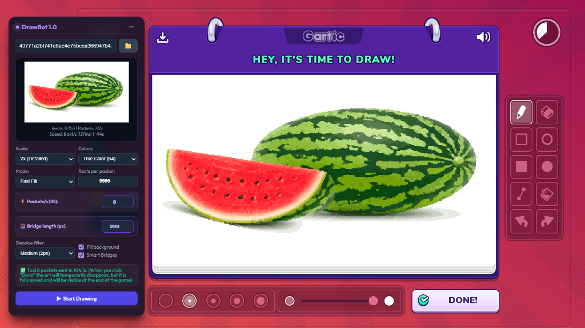

# 🎨 DrawBot for Gartic Phone

> **Automated drawing bot for [Gartic Phone](https://garticphone.com) — converts any image into in-game art via WebSocket packet injection.**



**Language / Язык:**  [English](#english) | [Русский](#русский)

---

<a id="english"></a>

# 🇬🇧 English

## Table of Contents

- [What's New in 2.1](#whats-new-in-21)
- [What's New in 2.0](#whats-new-in-20)
- [Features](#features)
- [Requirements](#requirements)
- [Installation](#installation)
- [Usage](#usage)
- [Animations: GIF, WebP and Video](#animations-gif-webp-and-video)
- [Settings Reference](#settings-reference)
- [Drawing Modes](#drawing-modes)
- [How Long Does It Take?](#how-long-does-it-take)
- [Tips & Recommendations](#tips--recommendations)
- [Troubleshooting](#troubleshooting)
- [How It Works](#how-it-works)

---

## What's New in 2.1

- 🎞 **GIFs, animated WebP/PNG and videos** — load an animation and the bot draws it frame by frame: frame 1 in round 1, frame 2 in round 2 and so on. In the game's **Animation** mode use `Standard Lines`: that mode has no fill tool, so Fast Fill does not work there. See [Animations](#animations-gif-webp-and-video)
- 🎨 **Own palette for each frame** — with *All frames*, each frame can pick its own colors instead of sharing one palette
- 📼 **All frames on one canvas** — draws the whole animation in a single round, frame over frame. The album replays drawings in the order they were drawn, so the replay plays the animation

---

## What's New in 2.0

- 🫥 **Invisible bridges** — every color now goes out as about **one packet**, instead of one packet per separate spot. Drawing is **25–100× faster**: a 256-color picture at 1x takes about 35 seconds instead of several minutes
- 🔲 **Fine grid at 1x** — at 1x the picture is drawn on cells of exactly 2×2 canvas pixels, so bridges fit everywhere and no parts go missing
- ⏱ **Much faster planning** — 2–9× faster; at 2x and coarser most of the work is skipped entirely. The plan made for the preview is reused when you press Start
- 🎛 **Three modes** — `Fast Fill`, `Fast Fill (old)` (the pre-2.0 behaviour, kept as a fallback) and `Standard Lines`
- 🎯 **Accurate timing** — packets go out 135 ms apart (at most 8 per second), and the estimate in the preview matches the real drawing time
- ⚙️ **New defaults** — 2x scale and True Color (32). Settings you already saved are kept

---

## Features

- 🖼 **Any image source** — a local file, an image URL, **Ctrl+V** from the clipboard, or drag & drop anywhere on the page
- 🎞 **Animations** — GIF, animated WebP/PNG and video (MP4, WebM) are drawn frame by frame, one frame per round or all frames on one canvas
- ⚡ **Fast Fill** — uses the game's own fill tool (Tool 8) and sends about one packet per color
- 🎨 **Flexible colors** — the game palette (18 colors), True Color with 8–256 colors, or every color as is
- 🌉 **Smart Bridges** — joins the remaining islands of a color through areas that are painted over later, and picks the color order that leaves the fewest islands
- 📐 **Layout** — stretch the image, center it, or place it in a custom box you drag and resize on the preview
- 📊 **Live preview** — shows the processed image, the number of rectangles and packets, and the estimated time
- 🔢 **Round field** — the current round is detected automatically and can be set by hand
- ⏸ **Pause / Resume / Cancel** at any moment, with a progress bar, the time remaining and the real sending speed
- 🛡 **Send tracking** — only packets that actually left are counted; failed packets are reported, and the bot stops if the connection is lost
- 💾 **Saved settings** — everything is stored in `localStorage` and restored on the next visit
- 🖱 **Draggable panel** with a minimize button

---

## Requirements

- A modern browser (Chrome, Firefox, Edge, Opera)
- **[Tampermonkey](https://www.tampermonkey.net/)** browser extension (or any UserScript manager: Violentmonkey, Greasemonkey, etc.)
- Gartic Phone in a desktop browser

---

## Installation

### Step 1 — Install Tampermonkey

1. Go to [tampermonkey.net](https://www.tampermonkey.net/)
2. Click **Download** for your browser and install the extension.

### Step 2 — Enable Developer Mode & Allow User Scripts (Crucial for Manifest V3)

To allow UserScripts to run in modern browsers:
1. Open your browser's extensions page (e.g., `chrome://extensions` in Chrome, `edge://extensions` in Edge).
2. Toggle the **Developer Mode** switch in the top-right corner to **ON**.
3. Click on the **Details** button of the **Tampermonkey** extension.
4. Locate the **Allow User Scripts** toggle and switch it to **ON**.
5. *If prompted*, grant any necessary permissions.

### Step 3 — Install the Script

You can install the script automatically with a single click:
1. Click this link: **[Install GarticPhoneDrawBot.user.js (One-Click)](https://raw.githubusercontent.com/notlun1x/Gartic-Phone-Auto-Draw/main/GarticPhoneDrawBot.user.js)**.
2. Tampermonkey will automatically open a tab displaying the script.
3. Click the **Install** (or **Update**) button.

*(Alternatively, you can create a new script in the Tampermonkey dashboard, copy the contents of [GarticPhoneDrawBot.user.js](GarticPhoneDrawBot.user.js), paste them into the editor, and press Ctrl+S).*

### Updating

Tampermonkey checks installed scripts for updates on its own (about once a day by default). To update right away, open the install link again and click **Update**, or use **Check for userscript updates** in the Tampermonkey menu. Your saved settings stay as they were.

---

## Usage

### Quick Start

1. **Open Gartic Phone** and join or create a game. The DrawBot panel appears in the top-left corner
2. **Wait for the drawing round** and make **one short brush stroke** on the canvas. The status changes to `Socket ready`, and the **Round** field shows the current round
3. **Load an image**:
   - click 📁 to pick a local file, **or**
   - paste an image URL into the text field, **or**
   - press **Ctrl+V** anywhere on the page to paste an image from the clipboard, **or**
   - drag an image file anywhere on the page (or an image from another tab onto the panel)
4. **Check the preview** and adjust the settings if needed. The line under the preview shows what will be sent, for example:
   `Rects: 41250 | Packets: 33` — `Speed: 8 pkt/s (135ms) | ~5s`
5. **Click ▶ Start Drawing**. The status shows the current color and the real sending speed
6. Wait for `✅ Drawing completed`, or use **⏸ Pause** / **⏹ Cancel** at any time

The image can be loaded before the drawing round, for example while the others are still writing. The plan is made for the canvas size seen last time and is redone automatically when the game canvas appears.

### Important Notes

- ⚠️ **Make at least one manual brush stroke** before starting. It lets the bot catch the game connection, the message format and the current round
- After the bot finishes and you click **Done**, the drawing may disappear from your screen — **this is normal**. It is saved on the server and shows up in the album at the end of the game
- Transparent parts of an image (PNG with alpha) are not drawn
- Don't draw by hand while the bot is working

---

## Animations: GIF, WebP and Video

Load a GIF, an animated WebP/PNG or a video (MP4, WebM) the same way as a picture: 📁, a link, or drag & drop. The **Animation** block appears under the image field:

| Control | What it does |
|---|---|
| **Frame** | The frame that is shown in the preview and drawn on Start. Picking a frame by hand switches *Frame follows round* off |
| **Frame follows round** | Round 1 draws frame 1, round 2 the next frame, and so on; after the last frame it starts over. On by default |
| **Step** | How many frames to move on per round (or, with *All frames*, which frames to draw: every Step-th). With a 60-frame GIF and 10 rounds, Step 6 spreads the rounds over the whole animation |
| **All frames on this canvas (album replay)** | Draws frames 1, 1+Step, 1+2·Step, … one over another on the current canvas (at most 200). The preview shows the total packets and time |
| **Video frames per second** | Videos only: how many frames are taken from each second of the clip (1–30, default 5). A 10-second clip at 5 gives 50 frames |
| **Own palette for each frame** | With *All frames* only: each frame gets its own N colors instead of one palette for the whole animation. Frames look closer to the source when the colors change a lot (fades, color cycling), but colors may flicker and more cells get redrawn, so it takes more packets. No effect with `Game palette` or `No limit`. Off by default |

> ⚠️ **The game's Animation mode has no fill tool**, so `Fast Fill` and `Fast Fill (old)` draw nothing there. Switch **Mode** to `Standard Lines` for it. Lines need far more packets than fills, so pick a coarse **Scale** (4x or more) and few colors (the game palette or True Color 8–16), and check the time in the preview so a frame fits into the round.

**All frames on one canvas.** The album shows a replay of how each drawing was made, so a drawing made of frames drawn one over another plays as an animation there. It is meant for the regular game modes with `Fast Fill`; with `Standard Lines` even a few frames rarely fit into a round. To keep it cheap:
- all frames share one palette, so colors do not flicker between frames (turn on *Own palette for each frame* when the frames' colors differ too much for one palette);
- from frame 2 on only the cells that change are drawn, so a still background costs nothing after frame 1;
- transparent parts are painted white, so they do not keep the previous frame.

Each frame still takes about one packet per color that changes, so the round timer is the limit: 12 frames of a simple GIF at 32 colors take ~45 s. Use fewer colors, a larger Step or a coarser Scale for longer animations. How smoothly the album replays it is up to the game.

Typical use in the game's **Animation** mode: load the GIF before the game starts, set **Mode** to `Standard Lines` with a coarse **Scale** and few colors, check that the **Round** field matches the game, then click **Start** and **Done** in each round.

Frames of GIF/WebP/PNG are decoded with the browser's `ImageDecoder`, which Chrome, Edge and Opera have. In other browsers an animated image is drawn as a still picture (its first frame). Videos work in every browser that can play them.


---

## Settings Reference

| Setting | What it does | Default | Recommended |
|---|---|---|---|
| **Scale** | Size of one image pixel. `1x` is the most detailed, `15x` the coarsest. In Fast Fill the drawing time depends on the number of colors, not on the scale | 2x | 1x–3x |
| **Colors** | `Game palette (18)` uses only the game's colors. `True Color (N)` picks the best N colors for the image. `No limit` keeps every color (photos can have thousands, so it is slow) | True Color (32) | True Color (32–64) |
| **Mode** | `Fast Fill`, `Fast Fill (old)` or `Standard Lines`, see [Drawing Modes](#drawing-modes) | Fast Fill | Fast Fill |
| **Rects per packet** | Max rectangles in one packet (fill modes only, up to 24000; both 12000 and 24000 were accepted in a live game). Bigger colors are split into several packets | 12000 | 12000 |
| **Layout** | `Stretch` fills the whole canvas, `Center` keeps the proportions, `Custom Scale` lets you drag and resize a box on the preview (or use the sliders), then click **Apply & Render Preview** | Stretch | — |
| **Round** | Current round, counted from 1 as in the game. Detected automatically; typing a number switches **Auto** off | Auto | Auto |
| **Packet delay (ms)** | Pause after each packet in Standard Lines mode | 127 | 127 |
| **⚡ Packets/s** | Sending speed in the fill modes, at most 8: faster sending gets packets dropped by the server. A 10 ms margin is added (8/s → 135 ms between packets) | 8 | 8 |
| **Denoise filter** | Repaints lone pixels that have fewer than 1/2/3 neighbours of the same color with the most common neighbouring color. White is never changed | Off | Off or Weak |
| **Fill background** | Fills the whole canvas with the most common color first, then skips that color | Off | On for images with a solid background |
| **Smart Bridges** | For colors that invisible bridges could not join completely, connects the islands through areas painted over later and searches for the best color order (fill modes only) | On | On |

---

## Drawing Modes

| Mode | How it draws | Packets | When to use |
|---|---|---|---|
| **Fast Fill** | Fill rectangles (Tool 8). All spots of a color are linked into one tree with invisible zero-size bridges | about 1 per color | Always, by default |
| **Fast Fill (old)** | The same rectangles without invisible bridges, as before 2.0. Only Smart Bridges join spots | one per separate spot, 25–100× more | If parts of the drawing go missing in the album |
| **Standard Lines** | Pen strokes and rectangles (Tools 1 and 6), one or two packets per shape | thousands | In the game's Animation mode (it has no fill tool), or if fill packets stop working in the game |

---

## How Long Does It Take?

In Fast Fill one packet goes out every 135 ms, so the time is roughly **number of colors × 0.135 s** (plus about 1 s for the background), whatever the scale:

| Colors | Approximate time |
|---|---|
| Game palette (18) | ~3 s |
| 32 | ~5 s |
| 64 | ~9 s |
| 256 | ~35 s |

Very large colors (over 12000 rectangles, usually at 1x) take an extra packet each. The preview always shows the exact packet count and time for the current image.

---

## Tips & Recommendations

1. **Best quality:** 1x–2x and True Color (64–256). With Fast Fill this costs only seconds
2. **Fastest:** fewer colors. The game palette or True Color (8–16) draws in 1–3 seconds
3. **Noisy image:** turn on the Denoise filter (Weak or Medium)
4. **Image with a plain background:** turn on Fill background — the largest color then costs one packet
5. **Placing a small picture:** choose Layout → Custom Scale and drag the box on the preview
6. **Minimize the panel** with ➖ while the bot is drawing

---

## Troubleshooting

| Problem | What to do |
|---|---|
| `WebSocket not found!` | Make one brush stroke on the canvas by hand. If it doesn't help, refresh the page and try again |
| `Enter the Gartic Phone drawing mode first!` | Start only when the drawing canvas is on screen |
| The drawing is missing in the album | The round may be wrong: uncheck **Auto** next to **Round** and enter the round number shown by the game |
| Parts of the drawing are missing | Switch to `Fast Fill (old)`. If that doesn't help, lower **Rects per packet** (try 1000) or **Packets/s** (try 6–7) |
| Nothing is drawn in the game's Animation mode | That mode has no fill tool. Switch **Mode** to `Standard Lines` |
| `Could not load image` for a link | Many sites don't allow other pages to read their images. Download the image and load it with 📁, or copy it and press Ctrl+V |
| A GIF loads as a still picture | Your browser has no `ImageDecoder` (e.g. Firefox). Use Chrome, Edge or Opera, or convert the animation to MP4/WebM |
| A video from a link does not load | The site does not allow downloading it from another page. Download the video and load it with 📁 |
| `⚠ … packets failed to send` | The connection was unstable; draw again on a new round or lower **Packets/s** |
| The browser asks "Leave site? Changes you made may not be saved" | The game asks this when the page is about to close or reload. Older versions let a file dropped next to the panel open in the tab, which triggered it: click **Cancel** to stay in the game, and update the script. Now a file dropped anywhere on the page is loaded into the bot |
| Start waits a moment before sending | The plan is being made (up to ~2 s at 1x with many colors). Normally it is ready from the preview |

---

## How It Works

### Architecture Overview

DrawBot is a Tampermonkey UserScript that runs entirely in the browser, inside the Gartic Phone page. It:

1. **Captures the WebSocket connection** to the game server
2. **Converts the image** into a grid of color indices
3. **Plans the drawing** — rectangles, links between them and packets
4. **Sends the packets** directly through the captured WebSocket at a steady rate

### WebSocket Interception

The script patches `WebSocket` and `WebSocket.prototype.send` at `document-start`, before the game loads:

- **Socket capture** — the first outgoing game message (`42[...`) links the socket to the bot
- **Message prefix** — the game's channel prefix (e.g. `42[2,7,`) is taken from outgoing messages, so the bot keeps working if it changes
- **Round tracking** — incoming and outgoing packets carry the round number (`turnNum` / `t`), which every drawing packet must contain. It is 0-based in packets and shown from 1 in the panel
- **Stroke IDs** — every drawing action has a `strokeId`. Bot strokes use a random range above 100000 that never goes backwards within a round and restarts when the round changes, so they never collide with the game's own strokes

### Image Processing Pipeline

1. **Grid** — the image is drawn onto a grid of `768/scale × 448/scale` cells, according to the Layout. At 1x such cells would be 1.9–2 px on the game canvas (about 1516×848), and rounding would make some rows and columns 1 px wide, where invisible bridges cannot attach. So at 1x in Fast Fill the grid is half the canvas size instead, with cells of exactly 2×2 px (1–5% fewer cells, not visible)
2. **Color quantization**:
   - *Game palette*: each pixel gets the nearest of 18 game colors (redmean color distance)
   - *True Color (N)*: shades are merged into clusters by frequency; for images with over 4096 distinct colors near-identical shades are merged first. Free palette slots are then filled with the colors that are worst represented, followed by 3 K-Means passes
   - *No limit*: all colors are used as they are
3. **Denoising** (optional) — lone pixels are repainted with their most common neighbour
4. **Animations** — a GIF/WebP/PNG is decoded frame by frame with `ImageDecoder`; a video is seeked to the middle of each frame's time slot and copied to a canvas. Only the selected frame is decoded (the last few are cached), and it then goes through the steps above like any picture
5. **Preview** — the processed grid is shown in the panel, together with the plan's numbers. Both the processed image and the plan are cached, so Start sends exactly what the preview showed

### Drawing Engine

#### Fast Fill (Tool 8)

A Tool 8 packet holds one color and a list of rectangles. The game only accepts a packet that forms a single tree: every rectangle must touch its parent with an end, strictly inside the touched side, without overlapping anything. A contact exactly at a corner, an overlap, or a part that touches nothing gets the whole packet rejected. This is what the planner builds:

1. **Background** (optional) — the most common color fills the whole canvas (sent twice, because the first fill packet is sometimes dropped)
2. **Rectangles** (`findMaximalRectangleOpt`) — each color's area is covered with large rectangles; for each one, "right then down" and "down then right" are tried and the bigger is kept
3. **Tree** (`buildRectangleTreeDFS`) — touching rectangles are linked parent to child in DFS order. Each separate spot of the color becomes its own tree
4. **Invisible bridges** (`linkIslandsWithInvisibleBridges`) — the trees are linked into one with rectangles of zero width or height, which paint nothing:
   - first straight bridges between neighbouring rectangles in the same row or column of the grid;
   - then L-shaped bridges for spots that share no line with the rest: along a row to a turn, then along a column to the main part (or the other way round).

   Bridges run strictly inside grid lines and never cross each other. The search is limited to the color's bounding box and uses sorted lists with binary search, so it stays fast even at 1x
5. **Smart Bridges and color order** — only if a color is still in pieces after that (rare since the 2×2 grid). The draw order is chosen greedily, from the last color backwards, so that each color is left with as few islands as possible (on a downsampled grid for large images). Then a multi-source BFS inside the color's bounding box connects its islands through pixels of colors drawn later, which paint over the bridge. The result is kept only if it does not add packets
6. **Packets** (`splitIntoChunks`) — a tree bigger than *Rects per packet* is cut along whole subtrees, so every packet is a connected tree that starts with a real rectangle. A frame is also capped at 700,000 characters

`Fast Fill (old)` skips steps 4 and the 2×2 grid: every spot that Smart Bridges can't join goes out as a separate packet.

#### Standard Lines (Tools 1 & 6)

1. **Rectangles** (`findMaxRectangles`) — rectangles of at least 2×2 cells become Tool 6 packets
2. **Paths** (`findPaths`) — the remaining thin lines are traced, preferring to keep the direction, and simplified (`simplifyPath`). Each path is a Tool 1 start packet plus one move packet
3. The pen width is `scale × 4 − 2` pixels; *Packet delay* is waited after every packet

### Network Protocol

Every drawing packet looks like this:
```
42[2,7,{"t":round,"d":action,"v":[tool, strokeId, ...]}]
```

- **Tool 1** — pen: `[1, id, [color, width, 10], x, y]`, then a move packet (`"d":3`) with the point deltas
- **Tool 6** — rectangle: `[6, id, [color, width, 10], x1, y1, x2, y2]`
- **Tool 8** — fill: `[8, id, [color, 10], x, y, w, h, parent, x, y, w, h, parent, ...]`, where `parent` is the position of the parent rectangle in the list × 5. Packets of up to 24000 rectangles (~440 KB) were accepted

### Timing & Safety

- **Pacing** — before each fill packet the bot waits until 135 ms have passed since the previous one (at 8 packets/s). Timer lateness is measured and subtracted from the next wait, so the real speed stays at ~7.4 packets/s and matches the estimate
- **Web Worker timers** — timers run in a Worker, so they are not throttled when the tab is in the background
- **Send tracking** — a send is retried up to 3 times; only packets that actually left the socket are counted. Failed packets are reported at the end, and the bot stops with an error if the connection is lost

---

<a id="русский"></a>

# 🇷🇺 Русский

## Содержание

- [Что нового в 2.1](#что-нового-в-21)
- [Что нового в 2.0](#что-нового-в-20)
- [Возможности](#возможности)
- [Требования](#требования)
- [Установка](#установка)
- [Использование](#использование)
- [Анимации: GIF, WebP и видео](#анимации-gif-webp-и-видео)
- [Описание настроек](#описание-настроек)
- [Режимы рисования](#режимы-рисования)
- [Сколько времени занимает рисование](#сколько-времени-занимает-рисование)
- [Советы и рекомендации](#советы-и-рекомендации)
- [Решение проблем](#решение-проблем)
- [Как работает бот](#как-работает-бот)

---

## Что нового в 2.1

- 🎞 **GIF, анимированные WebP/PNG и видео** — загрузите анимацию, и бот нарисует её по кадрам: кадр 1 в раунде 1, кадр 2 в раунде 2 и так далее. В режиме игры **Анимация** используйте `Standard Lines`: в этом режиме нет заливки, поэтому Fast Fill там не работает. См. [Анимации](#анимации-gif-webp-и-видео)
- 🎨 **Своя палитра у каждого кадра** — с *All frames* каждый кадр может подбирать свои цвета, а не делить одну палитру на всех
- 📼 **Все кадры на одном холсте** — рисует всю анимацию за один раунд, кадр поверх кадра. Альбом проигрывает рисунки в том порядке, в котором их рисовали, поэтому повтор показывает анимацию

---

## Что нового в 2.0

- 🫥 **Невидимые мосты** — каждый цвет теперь уходит примерно **одним пакетом**, а не отдельным пакетом на каждое пятно. Рисование **в 25–100 раз быстрее**: картинка на 256 цветов в 1x рисуется примерно за 35 секунд вместо нескольких минут
- 🔲 **Мелкая сетка на 1x** — на 1x рисунок строится из клеток ровно 2×2 пикселя холста, поэтому мосты помещаются везде и части рисунка не пропадают
- ⏱ **Намного более быстрое планирование** — в 2–9 раз; на 2x и крупнее большая часть работы вообще пропускается. План, построенный для превью, используется повторно при нажатии Start
- 🎛 **Три режима** — `Fast Fill`, `Fast Fill (old)` (поведение до 2.0, оставлено как запасной вариант) и `Standard Lines`
- 🎯 **Точное время** — пакеты уходят раз в 135 мс (не больше 8 в секунду), и оценка в превью совпадает с реальным временем рисования
- ⚙️ **Новые настройки по умолчанию** — масштаб 2x и True Color (32). Уже сохранённые настройки не меняются

---

## Возможности

- 🖼 **Любой источник картинки** — локальный файл, ссылка на изображение, **Ctrl+V** из буфера обмена или перетаскивание на панель
- 🎞 **Анимации** — GIF, анимированные WebP/PNG и видео (MP4, WebM) рисуются по кадрам, по кадру за раунд или все кадры на одном холсте
- ⚡ **Fast Fill** — использует инструмент заливки самой игры (Tool 8) и отправляет примерно один пакет на цвет
- 🎨 **Гибкая работа с цветами** — палитра игры (18 цветов), True Color на 8–256 цветов или все цвета как есть
- 🌉 **Умные мосты** — соединяют оставшиеся островки цвета через области, которые позже закрасятся, и подбирают порядок цветов, при котором островков меньше всего
- 📐 **Расположение** — растянуть картинку, поставить по центру или в свою рамку, которую можно двигать и менять на превью
- 📊 **Превью** — показывает обработанную картинку, число прямоугольников и пакетов и примерное время
- 🔢 **Поле раунда** — текущий раунд определяется автоматически и может быть задан вручную
- ⏸ **Пауза / Продолжить / Отмена** в любой момент, с прогресс-баром, оставшимся временем и реальной скоростью отправки
- 🛡 **Учёт отправки** — считаются только реально ушедшие пакеты; о неотправленных бот сообщает, а при потере соединения останавливается
- 💾 **Сохранение настроек** — всё хранится в `localStorage` и восстанавливается при следующем заходе
- 🖱 **Перетаскиваемая панель** с кнопкой сворачивания

---

## Требования

- Современный браузер (Chrome, Firefox, Edge, Opera)
- **[Tampermonkey](https://www.tampermonkey.net/)** — расширение для браузера (или любой менеджер UserScript-ов: Violentmonkey, Greasemonkey и т.д.)
- Gartic Phone в браузере на компьютере

---

## Установка

### Шаг 1 — Установите Tampermonkey

1. Перейдите на [tampermonkey.net](https://www.tampermonkey.net/)
2. Нажмите **Download** для вашего браузера и установите расширение.

### Шаг 2 — Включите Режим разработчика и Разрешите скрипты (Важно для Manifest V3)

Для того чтобы пользовательские скрипты могли запускаться в современных браузерах:
1. Перейдите на страницу расширений браузера (например, `chrome://extensions` в Chrome или `edge://extensions` в Edge).
2. В правом верхнем углу переведите переключатель **Режим разработчика** в положение **ВКЛ** (ON).
3. Нажмите кнопку **Сведения** (Details / Подробнее) у расширения **Tampermonkey**.
4. Найдите переключатель **Разрешить пользовательские скрипты** (Allow User Scripts) и переведите его в положение **ВКЛ**.
5. Подтвердите дополнительные разрешения, если расширение этого потребует.

### Шаг 3 — Установите скрипт

Скрипт можно установить автоматически в один клик:
1. Перейдите по ссылке: **[Установить GarticPhoneDrawBot.user.js (в один клик)](https://raw.githubusercontent.com/notlun1x/Gartic-Phone-Auto-Draw/main/GarticPhoneDrawBot.user.js)**.
2. Tampermonkey автоматически откроет новую вкладку со скриптом.
3. Нажмите кнопку **Установить** (или **Обновить**).

*(Альтернативно: вы можете создать новый скрипт в панели управления Tampermonkey, скопировать всё содержимое файла [GarticPhoneDrawBot.user.js](GarticPhoneDrawBot.user.js), вставить его в редактор и нажать Ctrl+S).*

### Обновление

Tampermonkey сам проверяет обновления установленных скриптов (по умолчанию примерно раз в день). Чтобы обновиться сразу, откройте ссылку установки ещё раз и нажмите **Обновить** или запустите проверку обновлений из меню Tampermonkey. Сохранённые настройки остаются как были.

---

## Использование

Интерфейс панели на английском, поэтому ниже названия кнопок и настроек приводятся так, как они написаны на панели.

### Быстрый старт

1. **Откройте Gartic Phone** и зайдите в игру или создайте её. Панель DrawBot появится в левом верхнем углу
2. **Дождитесь раунда рисования** и сделайте **один короткий мазок** кистью на холсте. Статус сменится на `Socket ready`, а в поле **Round** появится текущий раунд
3. **Загрузите изображение**:
   - нажмите 📁 и выберите файл, **или**
   - вставьте ссылку на изображение в текстовое поле, **или**
   - нажмите **Ctrl+V** в любом месте страницы, чтобы вставить картинку из буфера обмена, **или**
   - перетащите файл изображения в любое место страницы (или картинку из другой вкладки на панель)
4. **Проверьте превью** и при необходимости поменяйте настройки. Строка под превью показывает, что будет отправлено, например:
   `Rects: 41250 | Packets: 33` — `Speed: 8 pkt/s (135ms) | ~5s`
5. **Нажмите ▶ Start Drawing**. В статусе видно текущий цвет и реальную скорость отправки
6. Дождитесь `✅ Drawing completed` или используйте **⏸ Pause** / **⏹ Cancel** в любой момент

Картинку можно загрузить заранее, например пока остальные ещё пишут фразы. План строится под размер холста, который был в прошлый раз, и автоматически пересчитывается, когда появляется холст игры.

### Важные замечания

- ⚠️ **Сделайте хотя бы один мазок вручную** перед запуском. По нему бот находит соединение с игрой, формат сообщений и текущий раунд
- После завершения работы бота и нажатия **Готово** рисунок может исчезнуть с экрана — **это нормально**. Он сохранён на сервере и появится в альбоме в конце игры
- Прозрачные части картинки (PNG с альфа-каналом) не рисуются
- Не рисуйте вручную, пока работает бот

---

## Анимации: GIF, WebP и видео

GIF, анимированный WebP/PNG или видео (MP4, WebM) загружаются так же, как картинка: через 📁, ссылкой или перетаскиванием. Под полем для картинки появляется блок анимации:

| Элемент | Что делает |
|---|---|
| **Frame** (кадр) | Кадр, который показан в превью и рисуется по Start. Если выбрать кадр вручную, *Frame follows round* выключится |
| **Frame follows round** (кадр по раунду) | В раунде 1 рисуется кадр 1, в раунде 2 следующий и так далее; после последнего кадра всё начинается сначала. Включено по умолчанию |
| **Step** (шаг) | На сколько кадров сдвигаться за раунд (а с *All frames* — какие кадры рисовать: каждый Step-й). Для GIF из 60 кадров и 10 раундов шаг 6 растянет раунды на всю анимацию |
| **All frames on this canvas (album replay)** | Рисует кадры 1, 1+Step, 1+2·Step, … друг поверх друга на текущем холсте (не больше 200). Превью показывает общее число пакетов и время |
| **Video frames per second** | Только для видео: сколько кадров брать из каждой секунды ролика (1–30, по умолчанию 5). Ролик на 10 секунд при 5 даёт 50 кадров |
| **Own palette for each frame** (своя палитра у кадра) | Только с *All frames*: у каждого кадра свои N цветов вместо одной палитры на всю анимацию. Кадры ближе к оригиналу, когда цвета сильно меняются (затемнения, перелив цветов), но цвета могут мерцать и перерисовывается больше клеток, поэтому пакетов больше. С `Game palette` и `No limit` ничего не меняет. По умолчанию выключено |

> ⚠️ **В режиме игры «Анимация» нет заливки**, поэтому `Fast Fill` и `Fast Fill (old)` там ничего не рисуют. Для него переключите **Mode** на `Standard Lines`. Линиям нужно намного больше пакетов, чем заливке, поэтому берите крупный **Scale** (4x и больше) и мало цветов (палитра игры или True Color 8–16) и проверяйте время в превью, чтобы кадр успевал за раунд.

**Все кадры на одном холсте.** Альбом показывает повтор того, как рисовался каждый рисунок, поэтому рисунок из кадров, нарисованных друг поверх друга, проигрывается там как анимация. Это рассчитано на обычные режимы игры с `Fast Fill`; со `Standard Lines` даже несколько кадров редко успевают за раунд. Чтобы это было дёшево:
- у всех кадров одна общая палитра, поэтому цвета не мерцают между кадрами (включите *Own palette for each frame*, если цвета кадров слишком разные для одной палитры);
- начиная со второго кадра рисуются только клетки, которые изменились, поэтому неподвижный фон после первого кадра ничего не стоит;
- прозрачные части закрашиваются белым, чтобы на них не оставался предыдущий кадр.

Каждый кадр всё равно занимает примерно пакет на каждый изменившийся цвет, поэтому ограничение — таймер раунда: 12 кадров простой GIF на 32 цвета занимают ~45 с. Для длинных анимаций берите меньше цветов, больший Step или крупнее масштаб. Насколько плавно альбом это проиграет, зависит от игры.

Как обычно пользоваться в режиме игры **Анимация**: загрузите GIF до начала игры, поставьте **Mode** на `Standard Lines` с крупным **Scale** и малым числом цветов, проверьте, что поле **Round** совпадает с раундом в игре, и в каждом раунде нажимайте **Start**, а затем **Готово**.

Кадры GIF/WebP/PNG декодируются через браузерный `ImageDecoder`, который есть в Chrome, Edge и Opera. В других браузерах анимированная картинка рисуется как обычная (первый кадр). Видео работает в любом браузере, который умеет его воспроизводить.


---

## Описание настроек

| Настройка | Что делает | По умолчанию | Рекомендуется |
|---|---|---|---|
| **Scale** (масштаб) | Размер одного пикселя картинки. `1x` — самый детальный, `15x` — самый крупный. В Fast Fill время рисования зависит от числа цветов, а не от масштаба | 2x | 1x–3x |
| **Colors** (цвета) | `Game palette (18)` — только цвета игры. `True Color (N)` подбирает N лучших цветов для картинки. `No limit` оставляет все цвета (у фотографий их тысячи, поэтому это медленно) | True Color (32) | True Color (32–64) |
| **Mode** (режим) | `Fast Fill`, `Fast Fill (old)` или `Standard Lines`, см. [Режимы рисования](#режимы-рисования) | Fast Fill | Fast Fill |
| **Rects per packet** | Максимум прямоугольников в одном пакете (только режимы заливки, до 24000; и 12000, и 24000 игра приняла в живом тесте). Большие цвета делятся на несколько пакетов | 12000 | 12000 |
| **Layout** (расположение) | `Stretch` растягивает на весь холст, `Center` сохраняет пропорции, `Custom Scale` позволяет двигать и менять рамку на превью (или ползунками), после чего нужно нажать **Apply & Render Preview** | Stretch | — |
| **Round** (раунд) | Текущий раунд, считается с 1, как в игре. Определяется автоматически; если ввести число, **Auto** выключится | Auto | Auto |
| **Packet delay (ms)** | Пауза после каждого пакета в режиме Standard Lines | 127 | 127 |
| **⚡ Packets/s** | Скорость отправки в режимах заливки, не больше 8: при более быстрой отправке сервер теряет пакеты. Добавляется запас 10 мс (8/с → 135 мс между пакетами) | 8 | 8 |
| **Denoise filter** (шумоподавление) | Перекрашивает одиночные пиксели, у которых меньше 1/2/3 соседей того же цвета, в самый частый соседний цвет. Белый не меняется | Off | Off или Weak |
| **Fill background** (заливка фона) | Сначала заливает весь холст самым частым цветом, после чего этот цвет пропускается | Выкл | Вкл для картинок со сплошным фоном |
| **Smart Bridges** (умные мосты) | Для цветов, которые невидимые мосты не смогли связать целиком, соединяет островки через области, которые позже закрасятся, и подбирает лучший порядок цветов (только режимы заливки) | Вкл | Вкл |

---

## Режимы рисования

| Режим | Как рисует | Пакетов | Когда использовать |
|---|---|---|---|
| **Fast Fill** | Заливка прямоугольниками (Tool 8). Все пятна цвета связываются в одно дерево невидимыми мостами нулевой толщины | примерно 1 на цвет | Всегда, по умолчанию |
| **Fast Fill (old)** | Те же прямоугольники без невидимых мостов, как до 2.0. Пятна соединяют только Умные мосты | по одному на каждое отдельное пятно, в 25–100 раз больше | Если в альбоме пропадают части рисунка |
| **Standard Lines** | Мазки и прямоугольники (Tools 1 и 6), один-два пакета на фигуру | тысячи | В режиме игры «Анимация» (там нет заливки) или если пакеты заливки перестанут работать в игре |

---

## Сколько времени занимает рисование

В Fast Fill пакет уходит раз в 135 мс, поэтому время примерно равно **числу цветов × 0,135 с** (плюс около 1 с на фон) при любом масштабе:

| Цветов | Примерное время |
|---|---|
| Палитра игры (18) | ~3 с |
| 32 | ~5 с |
| 64 | ~9 с |
| 256 | ~35 с |

Очень большие цвета (больше 12000 прямоугольников, обычно на 1x) занимают по дополнительному пакету. Точное число пакетов и время для текущей картинки всегда показывает превью.

---

## Советы и рекомендации

1. **Лучшее качество:** 1x–2x и True Color (64–256). С Fast Fill это стоит всего несколько секунд
2. **Быстрее всего:** меньше цветов. Палитра игры или True Color (8–16) рисуются за 1–3 секунды
3. **Шумная картинка:** включите Denoise filter (Weak или Medium)
4. **Картинка с однотонным фоном:** включите Fill background — самый большой цвет тогда займёт один пакет
5. **Маленькая картинка в нужном месте:** выберите Layout → Custom Scale и перетащите рамку на превью
6. **Сверните панель** кнопкой ➖, пока бот рисует

---

## Решение проблем

| Проблема | Что делать |
|---|---|
| `WebSocket not found!` | Сделайте один мазок на холсте вручную. Если не помогло, обновите страницу и попробуйте снова |
| `Enter the Gartic Phone drawing mode first!` | Запускайте, только когда на экране холст для рисования |
| Рисунка нет в альбоме | Возможно, раунд определился неверно: снимите галочку **Auto** рядом с **Round** и введите номер раунда, который показывает игра |
| Пропадают части рисунка | Переключитесь на `Fast Fill (old)`. Если не помогло, уменьшите **Rects per packet** (например, до 1000) или **Packets/s** (до 6–7) |
| В режиме игры «Анимация» ничего не рисуется | В этом режиме нет заливки. Переключите **Mode** на `Standard Lines` |
| `Could not load image` для ссылки | Многие сайты не дают другим страницам читать свои картинки. Скачайте картинку и загрузите через 📁 или скопируйте её и нажмите Ctrl+V |
| GIF загружается как обычная картинка | В браузере нет `ImageDecoder` (например, Firefox). Используйте Chrome, Edge или Opera или переведите анимацию в MP4/WebM |
| Видео по ссылке не загружается | Сайт не разрешает скачивать его с других страниц. Скачайте видео и загрузите через 📁 |
| `⚠ … packets failed to send` | Соединение было нестабильным; нарисуйте заново в следующем раунде или уменьшите **Packets/s** |
| Браузер спрашивает «Покинуть сайт? Возможно, внесённые изменения не сохранятся» | Так игра реагирует, когда страница вот-вот закроется или перезагрузится. В старых версиях файл, брошенный рядом с панелью, открывался во вкладке вместо игры и вызывал этот вопрос: нажмите **Отмена**, чтобы остаться в игре, и обновите скрипт. Теперь файл, брошенный в любое место страницы, загружается в бот |
| После Start бот немного ждёт перед отправкой | Строится план (до ~2 с на 1x с большим числом цветов). Обычно он уже готов после превью |

---

## Как работает бот

### Общая архитектура

DrawBot — это UserScript для Tampermonkey, который работает целиком в браузере, внутри страницы Gartic Phone. Он:

1. **Перехватывает WebSocket-соединение** с сервером игры
2. **Преобразует картинку** в сетку индексов цветов
3. **Планирует рисование** — прямоугольники, связи между ними и пакеты
4. **Отправляет пакеты** напрямую через перехваченный WebSocket с постоянной скоростью

### Перехват WebSocket

Скрипт подменяет `WebSocket` и `WebSocket.prototype.send` на этапе `document-start`, до загрузки игры:

- **Захват сокета** — первое исходящее сообщение игры (`42[...`) связывает сокет с ботом
- **Префикс сообщений** — префикс канала игры (например, `42[2,7,`) берётся из исходящих сообщений, поэтому бот продолжит работать, если он изменится
- **Отслеживание раунда** — во входящих и исходящих пакетах есть номер раунда (`turnNum` / `t`), который обязан быть в каждом пакете рисования. В пакетах он считается с 0, а на панели показывается с 1
- **Stroke ID** — у каждого действия рисования есть `strokeId`. Бот берёт номера из случайного диапазона выше 100000, который не уменьшается в пределах раунда и начинается заново при смене раунда, поэтому они не пересекаются со штрихами самой игры

### Обработка изображения

1. **Сетка** — картинка рисуется на сетку `768/масштаб × 448/масштаб` клеток с учётом Layout. На 1x такие клетки на холсте игры (около 1516×848) были бы 1,9–2 px, и из-за округления часть строк и столбцов получалась бы шириной 1 px, где невидимые мосты не могут зацепиться. Поэтому на 1x в Fast Fill сетка берётся в половину холста, с клетками ровно 2×2 px (клеток на 1–5% меньше, на глаз незаметно)
2. **Квантование цветов**:
   - *Палитра игры*: каждому пикселю достаётся ближайший из 18 цветов игры (расстояние redmean)
   - *True Color (N)*: оттенки объединяются в кластеры по частоте; если у картинки больше 4096 разных цветов, почти одинаковые оттенки сначала сливаются. Свободные места в палитре заполняются цветами, которые хуже всего представлены, после чего идут 3 прохода K-Means
   - *Без лимита*: все цвета используются как есть
3. **Шумоподавление** (по желанию) — одиночные пиксели перекрашиваются в самый частый соседний цвет
4. **Анимации** — GIF/WebP/PNG декодируются по кадрам через `ImageDecoder`; видео перематывается на середину интервала каждого кадра, и кадр копируется на canvas. Декодируется только выбранный кадр (несколько последних кэшируются), дальше он проходит те же шаги, что и обычная картинка
5. **Превью** — обработанная сетка показывается на панели вместе с цифрами плана. И обработанная картинка, и план кэшируются, поэтому Start отправляет ровно то, что показало превью

### Движок рисования

#### Fast Fill (Tool 8)

Пакет Tool 8 содержит один цвет и список прямоугольников. Игра принимает пакет, только если он образует одно дерево: каждый прямоугольник должен касаться родителя концом строго внутри стороны и ничего не перекрывать. Касание точно в углу, перекрытие или часть, которая ничего не касается, — и весь пакет отбрасывается. Вот что строит планировщик:

1. **Фон** (по желанию) — самый частый цвет заливает весь холст (отправляется дважды, потому что первый пакет заливки игра иногда теряет)
2. **Прямоугольники** (`findMaximalRectangleOpt`) — область каждого цвета покрывается крупными прямоугольниками; для каждого пробуются «вправо, потом вниз» и «вниз, потом вправо», и берётся больший
3. **Дерево** (`buildRectangleTreeDFS`) — соприкасающиеся прямоугольники связываются «родитель — потомок» в порядке DFS. Каждое отдельное пятно цвета становится своим деревом
4. **Невидимые мосты** (`linkIslandsWithInvisibleBridges`) — деревья связываются в одно прямоугольниками нулевой ширины или высоты, которые ничего не закрашивают:
   - сначала прямыми мостами между соседними прямоугольниками в одной строке или столбце сетки;
   - затем Г-образными для пятен, у которых нет общей линии с остальными: по строке до поворота, затем по столбцу до основной части (или наоборот).

   Мосты идут строго внутри линий сетки и не пересекаются. Поиск ограничен рамкой цвета и использует отсортированные списки с двоичным поиском, поэтому остаётся быстрым даже на 1x
5. **Умные мосты и порядок цветов** — только если после этого цвет всё ещё по частям (с сеткой 2×2 это редкость). Порядок рисования подбирается жадно, начиная с последнего цвета, чтобы у каждого цвета осталось как можно меньше островков (для больших картинок — по уменьшенной сетке). Затем многоисточниковый BFS в пределах рамки цвета соединяет его островки через пиксели цветов, которые рисуются позже и закрасят мост. Результат берётся, только если пакетов не стало больше
6. **Пакеты** (`splitIntoChunks`) — дерево больше *Rects per packet* режется целыми поддеревьями, так что каждый пакет остаётся связным деревом и начинается с настоящего прямоугольника. Кадр также ограничен 700 000 символов

`Fast Fill (old)` пропускает шаг 4 и сетку 2×2: каждое пятно, которое не смогли соединить Умные мосты, уходит отдельным пакетом.

#### Standard Lines (Tools 1 и 6)

1. **Прямоугольники** (`findMaxRectangles`) — прямоугольники от 2×2 клеток становятся пакетами Tool 6
2. **Пути** (`findPaths`) — оставшиеся тонкие линии трассируются с предпочтением прежнего направления и упрощаются (`simplifyPath`). Каждый путь — это стартовый пакет Tool 1 и один пакет движения
3. Толщина кисти — `масштаб × 4 − 2` пикселей; после каждого пакета выдерживается *Packet delay*

### Сетевой протокол

Каждый пакет рисования выглядит так:
```
42[2,7,{"t":раунд,"d":действие,"v":[инструмент, strokeId, ...]}]
```

- **Tool 1** — кисть: `[1, id, [цвет, толщина, 10], x, y]`, затем пакет движения (`"d":3`) со смещениями точек
- **Tool 6** — прямоугольник: `[6, id, [цвет, толщина, 10], x1, y1, x2, y2]`
- **Tool 8** — заливка: `[8, id, [цвет, 10], x, y, w, h, parent, x, y, w, h, parent, ...]`, где `parent` — позиция родительского прямоугольника в списке × 5. Игра принимала пакеты до 24000 прямоугольников (~440 КБ)

### Тайминг и надёжность

- **Темп отправки** — перед каждым пакетом заливки бот ждёт, пока с предыдущего пройдёт 135 мс (при 8 пакетах/с). Опоздание таймера измеряется и вычитается из следующего ожидания, поэтому реальная скорость держится около 7,4 пакета/с и совпадает с оценкой
- **Таймеры в Web Worker** — таймеры работают в Worker, поэтому браузер не замедляет их в фоновой вкладке
- **Учёт отправки** — отправка повторяется до 3 раз; считаются только пакеты, которые действительно ушли в сокет. О неотправленных пакетах бот сообщает в конце, а при потере соединения останавливается с ошибкой

---
