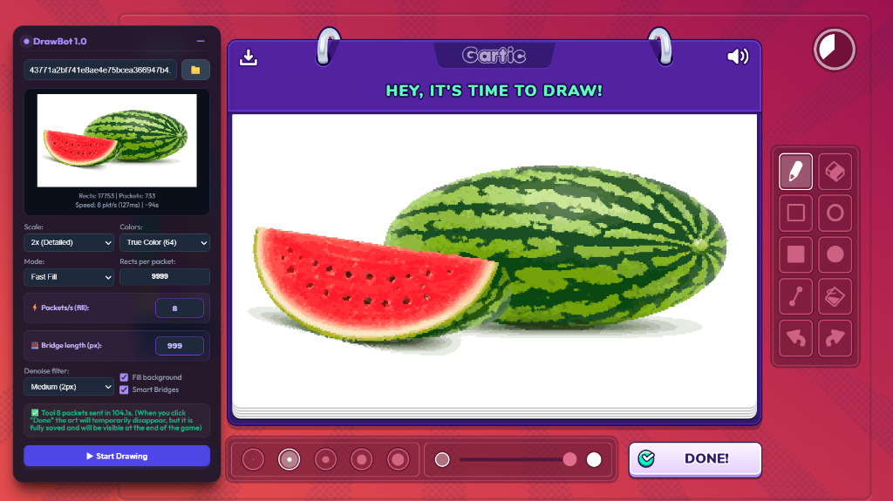

# 🎨 DrawBot for Gartic Phone

> **Automated drawing bot for [Gartic Phone](https://garticphone.com) — converts any image into in-game art via WebSocket packet injection.**



**Language / Язык:**  [English](#english) | [Русский](#русский)

---

<a id="english"></a>

# 🇬🇧 English

## Table of Contents

- [Features](#features)
- [Requirements](#requirements)
- [Installation](#installation)
- [Usage](#usage)
- [Settings Reference](#settings-reference)
- [Tips & Recommendations](#tips--recommendations)
- [How It Works](#how-it-works)

---

## Features

- 🖼 **Image-to-drawing conversion** — load any image (file, URL, Ctrl+V paste or drag & drop) and the bot draws it on the Gartic Phone canvas
- ⚡ **Fast Fill mode** — uses the game's native fill tool (Tool 8) for significantly faster drawing
- 🎨 **Flexible color modes** — Gartic palette (18 colors), True Color quantization (8–256 colors), or unlimited colors
- 🌉 **Smart Bridges** — connects isolated islands of a color and picks the color order that leaves the fewest of them
- 🫥 **Invisible bridges** — joins all islands of a color into one packet with zero-size links that paint nothing: 25–100× fewer packets
- 🔢 **Round field** — the current round is detected automatically and can be set by hand
- 📊 **Live preview** — see the quantized/downscaled result before drawing
- ⏸ **Pause / Cancel** — full control during the drawing process
- 📈 **Progress bar** — real-time progress with estimated time remaining
- 💾 **Persistent settings** — all settings are saved to `localStorage`
- 🖱 **Draggable UI panel** — glassmorphism-styled panel with minimize support

---

## Requirements

- A modern browser (Chrome, Firefox, Edge, Opera)
- **[Tampermonkey](https://www.tampermonkey.net/)** browser extension (or any UserScript manager: Violentmonkey, Greasemonkey, etc.)

---

## Installation

### Step 1 — Install Tampermonkey

1. Go to [tampermonkey.net](https://www.tampermonkey.net/)
2. Click **Download** for your browser and install the extension.

### Step 2 — Enable Developer Mode & Allow User Scripts (Crucial for Manifest V3)

To allow UserScripts to run in modern browsers:
1. Open your browser's extensions page (e.g., `chrome://extensions` in Chrome, `edge://extensions` in Edge).
2. Toggle the **Developer Mode** switch in the top-right corner to **ON**.
3. Click on the **Details** button of the **Tampermonkey** extension.
4. Locate the **Allow User Scripts** toggle and switch it to **ON**.
5. *If prompted*, grant any necessary permissions.

### Step 3 — Install the Script

You can install the script automatically with a single click:
1. Click this link: **[Install GarticPhoneDrawBot.user.js (One-Click)](https://raw.githubusercontent.com/notlun1x/Gartic-Phone-Auto-Draw/main/GarticPhoneDrawBot.user.js)**.
2. Tampermonkey will automatically open a tab displaying the script.
3. Click the **Install** (or **Update**) button.

*(Alternatively, you can create a new script in the Tampermonkey dashboard, copy the contents of [GarticPhoneDrawBot.user.js](GarticPhoneDrawBot.user.js), paste them into the editor, and press Ctrl+S).*

---

## Usage

### Quick Start

1. **Open Gartic Phone** and join/create a game
2. **Wait for the drawing round** — the bot panel will show `Socket ready` once the WebSocket is captured
3. **Load an image**:
   - Click the 📁 button to upload a local file, **or**
   - Paste an image URL into the text field, **or**
   - Press **Ctrl+V** anywhere on the page to paste an image from the clipboard, **or**
   - Drag an image file (or an image from another tab) onto the panel
4. **Adjust settings** (scale, colors, mode) and check the live preview
5. **Click ▶ Start Drawing** — the bot begins sending packets to the game server
6. Wait for completion, or use **⏸ Pause** / **⏹ Cancel** at any time

### Important Notes

- ⚠️ **Make at least one manual brush stroke** on the canvas before starting the bot. This is needed to initialize the WebSocket connection
- After the bot finishes and you click "Done" in the game, the art may temporarily disappear from your screen — **this is normal**. The drawing is fully saved on the server and will be visible at the end of the game
- If the socket isn't detected, try refreshing the page and drawing a stroke manually again
- If the art is missing in the album, the round may have been detected wrong: uncheck **Auto** next to **Round** and enter the round number shown in the game

---

## Settings Reference

| Setting | Description | Recommended |
|---|---|---|
| **Scale** | Downscale factor for the image. Higher = fewer pixels = faster, but lower quality | 3x–4x |
| **Colors** | Color quantization mode. `Gartic palette (18)` uses only the game's built-in colors; `True Color (N)` finds the optimal N colors via quantization | True Color (8) |
| **Mode** | `Fast Fill` uses Tool 8 (fill rectangles) and links all spots of a color with invisible bridges: about one packet per color. `Fast Fill (old)` is the same without invisible bridges: every separate spot is its own packet (much slower; a fallback if parts go missing in the album). `Standard Lines` uses Tools 1/6 (pen strokes and rectangles) — slowest but most compatible | Fast Fill |
| **Rects per packet** | Max rectangles bundled in a single WebSocket frame (Fast Fill only, up to 24000; both 12000 and 24000 were accepted in a live game). Lower it if parts of the drawing go missing | 12000 |
| **Layout** | How the image is placed: stretched, centered, or a custom box you can drag and resize on the preview | Stretch |
| **Round** | Current round, counted from 1 as in the game. Detected automatically; typing a number switches **Auto** off | Auto |
| **Packet delay (ms)** | Delay between packets in Standard Lines mode | 127 |
| **⚡ Packets/s (fill)** | Rate limiter for Fast Fill mode, capped at 8: faster sending gets packets dropped by the server | 8 |
| **Denoise filter** | Removes isolated noisy pixels from the quantized image | Off or Weak |
| **Fill background** | Flood-fills the entire canvas with the most common color first, then skips it during drawing | ✅ On |
| **Smart Bridges** | Connects islands of a color through areas painted over later (no length limit) and picks the color order that leaves the fewest islands | ✅ On |

---

## Tips & Recommendations

1. **For best quality:** use Scale 2x–3x + True Color (16–32) — gives rich detail but takes longer
2. **For speed:** use Scale 5x+ or Gartic palette + Fast Fill — draws in seconds
3. **If the art looks too "noisy":** enable the Denoise filter (Weak or Medium)
4. **If drawing drops packets:** lower Rects per packet (try 1000) or the Packets/s value (try 6–7)
5. **Use `Fast Fill`:** with invisible bridges it sends about one packet per color, 25–100× fewer than before. Switch to `Fast Fill (old)` only if parts of the drawing are missing in the album
6. **Minimize the panel** with the ➖ button while the bot is drawing to reduce visual clutter

---

## How It Works

### Architecture Overview

DrawBot is a Tampermonkey UserScript that operates entirely client-side, injecting itself into the Gartic Phone web page. It works by:

1. **Intercepting the WebSocket connection** to the game server
2. **Processing images** into a pixel grid with color quantization
3. **Generating optimized drawing commands** (rectangles and strokes)
4. **Sending packets** directly through the captured WebSocket

### WebSocket Interception

The script patches `WebSocket.prototype.send` at `document-start` (before the game loads). When Gartic Phone opens a WebSocket connection, DrawBot captures the instance and begins monitoring all traffic:

- **Socket prefix detection** — the game's internal channel ID is dynamically captured from outgoing messages (e.g., `42[2,7,`), ensuring compatibility even when the protocol changes
- **Turn ID synchronization** — the bot intercepts both incoming and outgoing packets to track the current `turnNum`, which is required in every drawing packet
- **Stroke ID tracking** — each drawing action has a `strokeId`. Bot strokes use a high random range (100000+) that never goes backwards within a round and restarts when the round changes, so they never collide with the game's own strokes

### Image Processing Pipeline

1. **Downscaling** — the image is scaled to a grid of `768/step × 448/step` pixels (where `step` is the Scale setting). At 1x that grid does not fit the game canvas (about 1516×848) evenly and some rows and columns would be 1 px wide, where invisible bridges cannot attach; so at 1x the grid is half the canvas size instead, with cells of exactly 2×2 px (1–5% fewer cells, not visible)
2. **Color quantization** — depending on the mode:
   - *Gartic palette*: maps each pixel to the nearest of 18 fixed game colors using weighted Euclidean distance (redmean formula)
   - *True Color (N)*: runs a custom quantization algorithm (frequency-sorted clustering + 3 K-Means refinement iterations) to find the best N colors
   - *Unlimited*: uses all unique colors as-is
3. **Denoising** (optional) — isolated pixels surrounded by fewer than `threshold` same-color neighbors are replaced with the most common neighboring color
4. **Preview rendering** — the quantized grid is drawn to an off-screen canvas and displayed in the UI

### Drawing Engine

#### Fast Fill Mode (Tool 8)

This is the primary and fastest drawing mode. `Fast Fill (old)` works the same way but skips the invisible bridges (and the 2×2 px grid at 1x), so every separate spot of a color goes out as its own packet. Fast Fill works by:

1. **Background flood fill** — the most common color fills the entire canvas first (one packet)
2. **Color ordering** (`chooseDrawOrder`) — every color is first linked with Invisible bridges alone; at 2x and coarser that already makes one tree per color, and nothing else runs. Only if some colors stay in pieces (typically at 1x, where some grid lines are 1 px), the draw order is searched so that each color is left with as few islands as possible: a greedy pass picks colors from the last one backwards. Large images are searched on a downsampled grid
3. **Per-color processing**:
   - A binary grid (0/1) is created for each color
   - **Smart Bridges** (`applyBridging`, only for colors left in pieces) — a multi-source BFS inside the color's bounding box finds paths between disconnected islands of the same color, with no length limit. Bridge pixels temporarily overwrite colors that are drawn later and repaint them. This uses Union-Find for efficient component merging
   - **Maximal rectangle decomposition** (`findMaximalRectangleOpt`) — for each pixel region, the algorithm finds the largest possible rectangle using a dual-strategy approach (expand right-then-down vs. down-then-right) and picks the one with greater area
   - **DFS tree construction** (`buildRectangleTreeDFS`) — rectangles are linked in a parent-child tree via DFS traversal. Each new rectangle is connected to the rectangle that spawned it. This preserves spatial adjacency, which is critical for the game's packet validation
   - **Invisible bridges** (`linkIslandsWithInvisibleBridges`) — the remaining islands are linked into one tree with zero-height or zero-width segments. First straight ones between neighbouring rectangles in the same grid row or column, then L-shaped ones for islands that share no line with the rest: along a row to a turn, then along a column to the main part (or the other way round). They paint nothing, and the game accepts them as long as every element touches its parent end-on, strictly inside the touched side, without overlaps (verified in a live game; a contact exactly on a corner is rejected), so one packet usually carries a whole color. Bridges run strictly inside grid lines and never cross each other
   - **Packet chunking** (`splitIntoChunks`) — the tree is cut into packets of at most *Rects per packet* entries along whole subtrees, so every packet stays a connected tree that starts with a real rectangle. Each frame stays under a 700,000-character safety cap

4. **Rate-limited sending** — packets are sent at the configured PPS rate (at most 8/s) using a Web Worker-based timer (accurate even in background tabs). A delta-sleep algorithm compensates for DOM update overhead to maintain a steady ~7.4 packets/s (135 ms apart) at the default setting

#### Standard Lines Mode (Tools 1 & 6)

A fallback mode that uses pen strokes and rectangles:

1. **Rectangle extraction** (`findMaxRectangles`) — finds maximal rectangles ≥ 2×2 in the color grid
2. **Path tracing** (`findPaths`) — remaining single-pixel lines are traced with directional momentum (prefers continuing the same direction). Paths are simplified via collinearity check (`simplifyPath`)
3. **Packet sending** — rectangles → Tool 6 packets, paths → Tool 1 (pen start + delta-move) packets

### Network Protocol

Each drawing packet follows this format:
```
42[channelId,7,{"t":turnId,"d":actionType,"v":[toolId, strokeId, [color, thickness, 10], ...data]}]
```

- **Tool 1** — pen stroke (start point + deltas)
- **Tool 6** — rectangle (two corner points)
- **Tool 8** — fill (color + array of rectangles with parent indices)

### Timing & Safety

- **Web Worker timers** — a dedicated Worker runs `setTimeout` to avoid browser throttling of inactive tabs
- **PPS limiter** — adds a +10 ms safety buffer (135 ms between packets at 8 packets/s) to the base interval to stay within server limits
- **Delta-sleep** — dynamically adjusts delay based on actual elapsed time since the last packet
- **Send tracking** — only packets that actually left the socket count as sent; the bot reports failed packets and stops with an error if the connection to the game is lost

---

<a id="русский"></a>

# 🇷🇺 Русский

## Содержание

- [Возможности](#возможности)
- [Требования](#требования)
- [Установка](#установка)
- [Использование](#использование)
- [Описание настроек](#описание-настроек)
- [Советы и рекомендации](#советы-и-рекомендации)
- [Как работает бот](#как-работает-бот)

---

## Возможности

- 🖼 **Конвертация изображения в рисунок** — загрузите любое изображение (файл, URL, вставка Ctrl+V или перетаскивание), и бот нарисует его на холсте Gartic Phone
- ⚡ **Режим быстрой заливки** — использует нативный инструмент заливки игры (Tool 8) для значительно более быстрого рисования
- 🎨 **Гибкие режимы цвета** — палитра Gartic (18 цветов), True Color квантование (8–256 цветов) или без ограничений
- 🌉 **Умные мосты** — соединяет изолированные островки одного цвета и подбирает порядок цветов, при котором их остаётся меньше всего
- 🫥 **Невидимые мосты** — объединяет все островки цвета в один пакет связями нулевой толщины, которые ничего не закрашивают: пакетов в 25–100 раз меньше
- 🔢 **Поле раунда** — текущий раунд определяется автоматически и может быть задан вручную
- 📊 **Превью в реальном времени** — просматривайте результат квантования и масштабирования перед рисованием
- ⏸ **Пауза / Отмена** — полный контроль во время процесса рисования
- 📈 **Прогресс-бар** — отображение прогресса в реальном времени с оценкой оставшегося времени
- 💾 **Сохранение настроек** — все настройки автоматически сохраняются в `localStorage`
- 🖱 **Перетаскиваемая UI-панель** — панель в стиле glassmorphism с возможностью сворачивания

---

## Требования

- Современный браузер (Chrome, Firefox, Edge, Opera)
- **[Tampermonkey](https://www.tampermonkey.net/)** — расширение для браузера (или любой менеджер UserScript-ов: Violentmonkey, Greasemonkey и т.д.)

---

## Установка

### Шаг 1 — Установите Tampermonkey

1. Перейдите на [tampermonkey.net](https://www.tampermonkey.net/)
2. Нажмите **Download** для вашего браузера и установите расширение.

### Шаг 2 — Включите Режим разработчика и Разрешите скрипты (Важно для Manifest V3)

Для того чтобы пользовательские скрипты могли запускаться в современных браузерах:
1. Перейдите на страницу расширений браузера (например, `chrome://extensions` в Chrome или `edge://extensions` в Edge).
2. В правом верхнем углу переведите переключатель **Режим разработчика** в положение **ВКЛ** (ON).
3. Нажмите кнопку **Сведения** (Details / Подробнее) у расширения **Tampermonkey**.
4. Найдите переключатель **Разрешить пользовательские скрипты** (Allow User Scripts) и переведите его в положение **ВКЛ**.
5. Подтвердите дополнительные разрешения, если расширение этого потребует.

### Шаг 3 — Установите скрипт

Скрипт можно установить автоматически в один клик:
1. Перейдите по ссылке: **[Установить GarticPhoneDrawBot.user.js (в один клик)](https://raw.githubusercontent.com/notlun1x/Gartic-Phone-Auto-Draw/main/GarticPhoneDrawBot.user.js)**.
2. Tampermonkey автоматически откроет новую вкладку со скриптом.
3. Нажмите кнопку **Установить** (или **Обновить**).

*(Альтернативно: вы можете создать новый скрипт в панели управления Tampermonkey, скопировать всё содержимое файла [GarticPhoneDrawBot.user.js](GarticPhoneDrawBot.user.js), вставить его в редактор и нажать Ctrl+S).*

---

## Использование

### Быстрый старт

1. **Откройте Gartic Phone** и зайдите/создайте игру
2. **Дождитесь раунда рисования** — панель бота покажет `Сокет готов`, как только WebSocket будет перехвачен
3. **Загрузите изображение**:
   - Нажмите кнопку 📁 для загрузки локального файла, **или**
   - Вставьте URL изображения в текстовое поле, **или**
   - Нажмите **Ctrl+V** в любом месте страницы, чтобы вставить картинку из буфера обмена, **или**
   - Перетащите файл изображения (или картинку из другой вкладки) на панель
4. **Настройте параметры** (масштаб, цвета, режим) и проверьте превью
5. **Нажмите ▶ Запустить рисование** — бот начнёт отправку пакетов на сервер игры
6. Дождитесь завершения или используйте **⏸ Пауза** / **⏹ Отмена** в любой момент

### Важные замечания

- ⚠️ **Сделайте хотя бы один мазок кистью** на холсте перед запуском бота. Это нужно для инициализации WebSocket-соединения
- После завершения работы бота и нажатия «Готово» в игре рисунок может временно исчезнуть с экрана — **это нормально**. Рисунок полностью сохранён на сервере и будет виден в конце игры
- Если сокет не определился — попробуйте обновить страницу и снова нарисовать мазок вручную
- Если рисунка нет в альбоме, возможно, раунд определился неверно: снимите галочку **Auto** рядом с **Round** и введите номер раунда, который показывает игра

---

## Описание настроек

| Настройка | Описание | Рекомендуемое значение |
|---|---|---|
| **Масштаб** | Коэффициент уменьшения изображения. Выше = меньше пикселей = быстрее, но ниже качество | 3x–4x |
| **Цвета** | Режим квантования цветов. `Палитра игры (18)` использует только встроенные цвета Gartic; `True Color (N)` находит оптимальные N цветов | True Color (8) |
| **Режим** | `Fast Fill` использует Tool 8 (прямоугольники) и связывает все пятна цвета невидимыми мостами: примерно один пакет на цвет. `Fast Fill (old)` — то же без невидимых мостов: каждое отдельное пятно уходит своим пакетом (намного медленнее; запасной вариант, если в альбоме пропадают части рисунка). `Standard Lines` использует Tools 1/6 (мазки и прямоугольники) — самый медленный, но самый совместимый | Fast Fill |
| **Квадратов в пакете** | Максимум прямоугольников в одном WebSocket-кадре (только для быстрой заливки, до 24000; и 12000, и 24000 игра приняла в живом тесте). Уменьшите, если части рисунка пропадают | 12000 |
| **Расположение** | Как разместить картинку: растянуть, по центру или в своей рамке, которую можно двигать и менять в превью | Растянуть |
| **Раунд** | Текущий раунд, считается с 1, как в игре. Определяется автоматически; если ввести число, **Auto** выключится | Auto |
| **Задержка пакетов (ms)** | Задержка между пакетами в режиме обычных линий | 127 |
| **⚡ Пакетов/с (заливка)** | Ограничитель скорости для режима быстрой заливки, не больше 8: при более быстрой отправке сервер теряет пакеты | 8 |
| **Фильтр шума** | Удаляет изолированные шумовые пиксели из квантованного изображения | Выкл или Слабый |
| **Заливка фона** | Заливает весь холст самым частым цветом, после чего пропускает его при рисовании | ✅ Вкл |
| **Умные мосты** | Соединяет островки одного цвета через области, которые позже закрасятся (без ограничения длины), и подбирает порядок цветов, при котором островков остаётся меньше всего | ✅ Вкл |

---

## Советы и рекомендации

1. **Для лучшего качества:** используйте масштаб 2x–3x + True Color (16–32) — даёт детальный рисунок, но занимает больше времени
2. **Для скорости:** используйте масштаб 5x+ или палитру Gartic + быструю заливку — рисует за секунды
3. **Если рисунок выглядит «шумным»:** включите фильтр шума (Слабый или Средний)
4. **Если пакеты теряются:** уменьшите «Квадратов в пакете» (попробуйте 1000) или Пакетов/с (попробуйте 6–7)
5. **Используйте `Fast Fill`:** с невидимыми мостами он отправляет примерно один пакет на цвет, в 25–100 раз меньше, чем раньше. На `Fast Fill (old)` стоит переключаться, только если в альбоме пропадают части рисунка
6. **Сверните панель** кнопкой ➖, пока бот рисует, чтобы уменьшить визуальный шум

---

## Как работает бот

### Общая архитектура

DrawBot — это UserScript для Tampermonkey, который работает полностью на стороне клиента, встраиваясь в веб-страницу Gartic Phone. Принцип работы:

1. **Перехват WebSocket-соединения** с игровым сервером
2. **Обработка изображений** — преобразование в пиксельную сетку с квантованием цветов
3. **Генерация оптимизированных команд рисования** (прямоугольники и штрихи)
4. **Отправка пакетов** напрямую через захваченный WebSocket

### Перехват WebSocket

Скрипт патчит `WebSocket.prototype.send` на этапе `document-start` (до загрузки игры). Когда Gartic Phone открывает WebSocket-соединение, DrawBot захватывает экземпляр и начинает мониторинг всего трафика:

- **Определение префикса** — внутренний ID канала игры динамически захватывается из исходящих сообщений (например, `42[2,7,`), что обеспечивает совместимость даже при изменении протокола
- **Синхронизация Turn ID** — бот перехватывает входящие и исходящие пакеты для отслеживания текущего `turnNum`, который обязателен в каждом пакете рисования
- **Отслеживание Stroke ID** — каждое действие рисования имеет `strokeId`. Штрихи бота берут номера из высокого случайного диапазона (от 100000), который не уменьшается в пределах раунда и начинается заново при смене раунда, поэтому они не пересекаются со штрихами самой игры

### Конвейер обработки изображений

1. **Масштабирование** — изображение уменьшается до сетки `768/step × 448/step` пикселей (где `step` — значение настройки «Масштаб»). На 1x такая сетка неровно ложится на холст игры (около 1516×848), и часть строк и столбцов получалась бы шириной 1 px, где невидимые мосты не могут зацепиться; поэтому на 1x сетка берётся ровно в половину холста, с клетками 2×2 px (клеток на 1–5% меньше, на глаз незаметно)
2. **Квантование цветов** — в зависимости от режима:
   - *Палитра Gartic*: каждый пиксель сопоставляется с ближайшим из 18 фиксированных цветов игры с помощью взвешенного евклидова расстояния (формула redmean)
   - *True Color (N)*: запускается алгоритм квантования (кластеризация по частоте + 3 итерации K-Means) для нахождения оптимальных N цветов
   - *Без лимита*: используются все уникальные цвета как есть
3. **Шумоподавление** (опционально) — изолированные пиксели, окружённые менее чем `threshold` пикселями того же цвета, заменяются наиболее частым соседним цветом
4. **Рендеринг превью** — квантованная сетка рисуется на off-screen canvas и отображается в UI

### Движок рисования

#### Режим быстрой заливки (Tool 8)

Основной и самый быстрый режим рисования. `Fast Fill (old)` работает так же, но без невидимых мостов (и без сетки 2×2 px на 1x), поэтому каждое отдельное пятно цвета уходит своим пакетом. Fast Fill работает следующим образом:

1. **Заливка фона** — самый частый цвет заливает весь холст одним пакетом
2. **Порядок цветов** (`chooseDrawOrder`) — сначала каждый цвет связывается одними Невидимыми мостами; на 2x и крупнее это уже даёт одно дерево на цвет, и больше ничего не запускается. Только если какие-то цвета остались по частям (обычно на 1x, где часть линий сетки шириной 1 px), порядок подбирается так, чтобы у каждого цвета осталось как можно меньше островков: жадный проход выбирает цвета начиная с последнего. Для больших изображений поиск идёт по уменьшенной сетке
3. **Обработка каждого цвета**:
   - Создаётся бинарная сетка (0/1) для каждого цвета
   - **Умные мосты** (`applyBridging`, только для цветов, оставшихся по частям) — многоисточниковый BFS в пределах рамки цвета ищет пути между несвязанными островками одного цвета, без ограничения длины. Пиксели-мосты временно перекрашивают цвета, которые рисуются позже и закрасят их. Для эффективного объединения компонент используется Union-Find
   - **Декомпозиция на максимальные прямоугольники** (`findMaximalRectangleOpt`) — для каждого региона алгоритм находит наибольший возможный прямоугольник двумя стратегиями (расширение вправо-вниз vs. вниз-вправо) и выбирает вариант с большей площадью
   - **Построение DFS-дерева** (`buildRectangleTreeDFS`) — прямоугольники связываются в дерево «родитель-потомок» через обход DFS. Каждый новый прямоугольник соединяется с тем, который его породил. Это сохраняет пространственную смежность, критичную для валидации пакетов игрой
   - **Невидимые мосты** (`linkIslandsWithInvisibleBridges`) — оставшиеся островки связываются в одно дерево отрезками нулевой высоты или ширины. Сначала прямыми между соседними прямоугольниками в одной строке или столбце сетки, затем Г-образными для островков, у которых нет общей линии с остальными: по строке до поворота, затем по столбцу до основной части (или наоборот). Они ничего не закрашивают, а игра принимает их, пока каждый элемент касается родителя концом строго внутри стороны и ничего не перекрывается (проверено в живой игре; касание точно в углу отбрасывается), поэтому один пакет обычно несёт весь цвет. Мосты идут строго внутри линий сетки и не пересекаются
   - **Разбиение на пакеты** (`splitIntoChunks`) — дерево режется на пакеты не больше *Квадратов в пакете* элементов целыми поддеревьями, так что каждый пакет остаётся связным деревом и начинается с настоящего прямоугольника. Каждый кадр не превышает страховочный лимит в 700 000 символов

4. **Отправка с ограничением скорости** — пакеты отправляются с настроенной PPS-скоростью (не больше 8/с) через таймер на Web Worker (точный даже в фоновых вкладках). Алгоритм delta-sleep компенсирует накладные расходы на обновление DOM для поддержания стабильной скорости ~7.4 пакета/с (135 мс между пакетами) при стандартных настройках

#### Режим обычных линий (Tools 1 и 6)

Запасной режим, использующий мазки и прямоугольники:

1. **Извлечение прямоугольников** (`findMaxRectangles`) — находит максимальные прямоугольники ≥ 2×2 в сетке цвета
2. **Трассировка путей** (`findPaths`) — оставшиеся однопиксельные линии трассируются с инерцией направления (предпочитает продолжение в том же направлении). Пути упрощаются проверкой коллинеарности (`simplifyPath`)
3. **Отправка пакетов** — прямоугольники → пакеты Tool 6, пути → пакеты Tool 1 (начальная точка + дельты)

### Сетевой протокол

Каждый пакет рисования имеет следующий формат:
```
42[channelId,7,{"t":turnId,"d":actionType,"v":[toolId, strokeId, [color, thickness, 10], ...data]}]
```

- **Tool 1** — мазок кистью (начальная точка + дельты перемещений)
- **Tool 6** — прямоугольник (две угловые точки)
- **Tool 8** — заливка (цвет + массив прямоугольников с индексами родителей)

### Тайминг и безопасность

- **Таймеры Web Worker** — выделенный Worker выполняет `setTimeout` для обхода троттлинга браузером неактивных вкладок
- **PPS-лимитер** — добавляет буфер безопасности +10 мс (135 мс между пакетами при 8 пакетах/с) к базовому интервалу для гарантии нахождения в пределах лимитов сервера
- **Delta-sleep** — динамически подстраивает задержку на основе реального времени с момента последнего пакета
- **Учёт отправки** — отправленными считаются только пакеты, которые действительно ушли в сокет; бот сообщает о неотправленных пакетах и останавливается с ошибкой, если соединение с игрой потеряно

---
